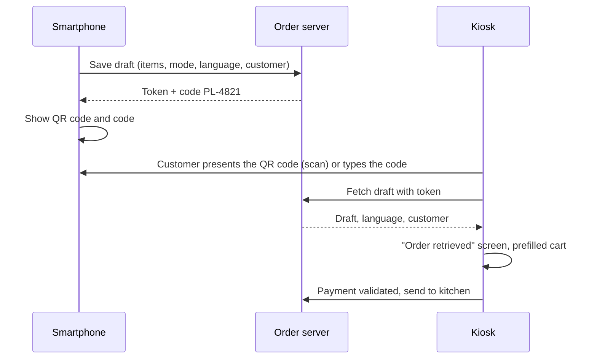

# PastaLaVista — complete project context

AI-facing file (English). It is the single place that gathers everything known about the project. **Read it fully before working.** Keep it accurate: update it whenever a decision changes. Human-facing documents are in French under `docs/`; agent rules are in `AGENTS.md` (and `CLAUDE.md`, which imports it).

If this file conflicts with the instructors' PDFs (`subject_definition/`), the PDFs win. If it conflicts with a more recent instruction from the user, the user wins and this file must be updated.

## Table of contents

1. Project identity and rules of engagement
2. The subject (assignment) in detail
3. The course (theory to apply)
4. Decisions log
5. Business domain and mock data
6. Personas and scenarios
7. Users axis: specification
8. Devices axis: specification
9. Composition of adaptations
10. Adaptation rules (catalogue)
11. UI design specification (kiosk, smartphone, tokens, screens, components)
12. Technical architecture (React + Vite)
13. Stage 2: adaptation engine and AI
14. Quality: continuity, accessibility, privacy, testing
15. Repository map and artefacts
16. Glossary (FR/EN)
17. Open questions, risks, assumptions
18. Do and don't for AI agents

---

## 1. Project identity and rules of engagement

- **Name:** PastaLaVista (a fictional pasta fast-food chain; French context).
- **Course:** SI5, semester S10, "Adaptation" (adaptive UIs / plasticity), academic year 2026-2027.
- **Instructors:** Christian Brel and Anne-Marie Pinna. They must be invited to the Git repository. Slack: `#si5-adaptation` plus a private group channel `#si5-adaptation-<GROUP NAME>` (group name not decided).
- **Team:** a group of at most 4 students. Every member is graded **individually**: contributions must be visible and attributable (readable history, no AI as co-author).
- **Repository:** local folder `PastaLaVista/`, git, single branch `main` with one initial commit. `subject_definition/` is untracked as of writing. Remote `origin/main` exists.
- **Language policy (hard rule):** files read by humans (docs, READMEs, comments, commit messages, PR text) are in **French**; files read by AI agents (`AGENTS.md`, `CLAUDE.md`, `context.md`, memory) are in **English**; code identifiers are in English.
- **Git policy (hard rule):** never add an AI as co-author (no `Co-Authored-By`, no "Generated with" lines); never push or commit on `main`; use branches; commit or push only when asked.
- **Scope policy:** do only what is asked. No extra features, docs or dependencies.

## 2. The subject (assignment) in detail

Title: *Adaptation d'un parcours de commande (menu / commande / paiement) dans un fastfood.*

**Customer tasks:** 1. choose products, 2. order, 3. pay.

**Business stakes (kiosk = main touchpoint):** fluidify queues when necessary and maximise the average basket, notably through relevant upselling. Objectives: (1) have a maximum of customers and satisfy them; (2) get a maximum of orders (push products and offers).

**Deliverables for every group:**
- the **standard UIs** (satisfying for all customers);
- the study and implementation of the adaptations for the **Users axis** and for **one other axis** of the group's choice (Devices **or** Environment). The adaptations are **runtime** adaptations that favour how people order, pay and react to promotional offers.

### 2.1 Users axis (mandatory)

Personalise the ordering journey dynamically from the first seconds. Points to answer:
1. Identify different user groups.
2. Choose 2 groups quite different in their expectations.
3. Build a **comparison table of UI journeys**: identify comparison criteria relative to the main tasks of the personas.
4. **Mock up** the standard UIs and those of the 2 chosen personas.
5. Identify how to **recognise a profile dynamically**.
6. Identify how to **switch from a standard UI to a personalised UI**.

### 2.2 Devices axis (chosen)

Some fast-foods offer a hybrid solution: smartphone and kiosk. The customer uses the smartphone to configure the order on the move or before coming, and uses the physical kiosk to finalise the purchase and start kitchen preparation. Points to answer:
1. Identify the **tasks offered on each device**.
2. Build a **comparison table of UI journeys**: criteria relative to the tasks assigned to each device and to the specifics of the devices.
3. Identify the **impacted standard UIs** and **mock up the new adapted smartphone UIs**.
4. Identify how to **recognise dynamically the change of device**.
5. Identify how to **go from the smartphone UI to the kiosk UI**.
6. Identify the **possibility of adding a chatbot** for taking orders.

### 2.3 Environment axis (NOT chosen, reference only)

Two sub-topics: **weather** (scenarios: heatwave/bright sun, or heavy rain/freezing cold) and **rush** (calm restaurant mode vs rush mode). Both ask for: new UI goals, impact on the journey, comparison table, impacted UIs and mock-ups, dynamic detection, transition standard ↔ adapted and back. **Out of scope for this project.**

### 2.4 Stages and expected work

**Stage 1 — UX research and specifications (first 3 sessions; evaluation at session 4):**
- usage scenarios;
- high-fidelity mock-ups;
- comparison tables = adaptation matrices;
- adaptation rules;
- front-end code of the interfaces, **without interconnection**;
- consider the **compositions** of the chosen adaptations.

Instructors' expectations for stage 1 (mock-ups and front-end must take into account): (1) adaptation levels: **presentation** (visuals, components), **content** (useful information), **behaviour** (interactions); (2) experience-continuity guidelines; (3) minimal accessibility (contrasts, minimum click-target size). Also identify **detection criteria** (time factor, input speed, navigation pattern, simultaneity of choices, modification of recipes...) and fill in the adaptation matrices.

**Stage 2 — implementation analysis and proof of concept (3 sessions; evaluation at session 8):**
- a solution with an **adaptation engine and static adaptation rules**;
- a solution with **several AI techniques and a multi-level use** (context identification and UI generation).

**Organisation:** groups of at most 4; front design and implementation during the first 3 weeks; adaptations implemented during 3 weeks (with and without AI); code on Git with instructors invited; everyone involved (individual grade).

## 3. The course (theory to apply)

Source: `IHMAdaptativesCours1-20262027.pdf`.

- **Plasticity** (Joëlle Coutaz, Interact'99): capacity of a UI to adapt to its context of use while respecting its usability.
- **Context of use = triplet:** User, Platform, Environment. This project covers **User** and **Platform**.
- **Design-time adaptation** (initiated by the user, then handled by the system) vs **runtime adaptation** (initiated and handled by the system). Runtime is the target here.
- **Plasticity domain and threshold:** the contexts covered by the UI; beyond the threshold, usability is lost.
- **Feature ≠ adaptation:** a feature answers a user need; a context change keeps the need but introduces a variation.
- **Where do changes come from:** devices (purchase, breakdown, place), environment (mobility, noise, day/night), user abilities (occupied hands, acquired expertise).
- **Adaptation matrix (3 parts):** (1) context variables (inputs), (2) UI components (outputs: modality, layout, textual content, dialogue flow, i.e. content/presentation/dialogue), (3) transition rules (state A → state B). Build it by listing the possible values of each triplet element, specifying when a value changes, identifying tasks needing an adapted view, listing the impact on content/presentation/dialogue, then defining transition rules. A matrix can be simplified when the impact is limited (e.g. brightness changes presentation only).
- **Worked examples:** ADHD children QCM (add explanations, an animation, a relaxing game, condition on response time; "progressive but visible arrival of new possibilities"); brightness (thresholds X and Y for contrast); battery low → app migrates to a nearby smartphone (device continuity).
- **Cognitive load:** hide information irrelevant at time T; facilitate task execution and verify it was done correctly.
- **Transitions (4 rules):** preserve state (focus, typed data, open option, cart); smooth visuals (about 300 ms ease-in-out, no flicker, elements move apart when text grows); identify the right moment (only a significant and stable change, e.g. "bright sun" if > 10 000 lux for 3 s; **hysteresis**: activate above 80 %, deactivate below 50 %); keep the structure (skeleton, critical buttons in the same place, reconfigure rather than jump screens).
- **Layout changes:** split-screen/list, focused/large grid, linear tunnel; consider whether the change is occasional or persistent (inattentive child vs ADHD child).
- **Personalisation:** static (user-declared profile, or pre-existing expert profile), passive/dynamic (automatic profiling, starting from a prototype profile, refined as used), interactive (neutral product that learns; user both active and passive; AI-enabled).
- **User profile inference:** interaction history, behavioural habits, psychological state (stress, fatigue), context identification.
- **Sensitive data:** GDPR (privacy, individual rights) and adequate security.

## 4. Decisions log

| Date | Decision |
|---|---|
| 2026-11-23 | Project folder `PastaLaVista/`; agent rules in `AGENTS.md` and `CLAUDE.md`; this file created |
| 2026-11-23 | User groups: tourists unfamiliar with pasta who cannot cook; young adults / working people |
| 2026-11-23 | Personas: **Jérémy Martin** (regular, has an account) and **Alexovitch Dimitri Alexei** (Russian tourist, no French, slow) |
| 2026-11-23 | **Second axis = Devices** (smartphone + kiosk). Environment (weather, rush) is **not** done |
| 2026-11-23 | Tasks: smartphone prepares the order (no payment); kiosk retrieves it by QR code, pays, starts the kitchen. Hypothesis to validate |
| 2026-11-23 | Chatbot considered on smartphone for Alexovitch (point 6 of the Devices axis) |
| 2026-11-23 | Kiosk UI redesigned to look like a **real kiosk** (strongly different from the smartphone UI) |
| 2026-11-23 | **Stack: React + Vite**; maximise reusable components shared by kiosk and smartphone |
| 2026-11-23 | High-fidelity prototype built in a Claude Design canvas and exported as a standalone HTML file |
| 2026-11-23 | Human docs in French, AI files in English; never AI co-author; never push to `main` |
| 2026-11-23 | Help is **offered, never imposed**: with no answer the UI stays standard (stricter than `docs/adaptation-alexei-lenteur.md`, which switched to guided mode on no answer) |
| 2026-11-23 | **Full-stack implementation**: npm-workspaces monorepo (`apps/web`, `apps/api`, `packages/shared`), TypeScript strict everywhere, Fastify API, no database yet (in-memory repositories behind domain ports), Vitest. See section 12 and `docs/architecture.md` |

## 5. Business domain and mock data

All data below is **fictitious mock data** used by the prototype. Replace it before any real use.

**Order modes:** on site (*sur place*) or takeaway (*à emporter*).

**Pasta (base price):** Penne 8,50 €; Spaghetti 8,50 €; Tagliatelle 9,00 €; Complètes (whole-wheat, slow carbs) 9,00 €. Portion XL: +2,00 €.
**Sauces:** Tomate basilic (included); Bolognaise +1,00 €; Pesto +1,00 €; Crème champignons +1,00 €.
**Toppings (garnitures):** Poulet grillé +2,50 €; Thon +2,00 €; Œuf +1,00 €; Mozzarella +1,50 €; Légumes grillés +1,50 €.
**Extras:** Parmesan +0,50 €; Pain à l'ail +1,50 €; Boisson +1,50 €.
**Drinks:** Eau 1,50 €; Limonade 1,50 €; Jus d'orange 2,00 €.
**Popular compositions:** La Classique 9,50 € (Penne, tomate basilic); La Veggie 10,00 € (Spaghetti, pesto, légumes); La Protéinée 13,00 € (Complètes, bolognaise, poulet).
**Menu categories:** Composer, Populaires, Boissons, Desserts, Menus (Desserts and Menus have no content yet).

**Nutrition (per portion, mock):** Poulet grillé 165 kcal / 31 g protein; Thon 110 / 24; Œuf 78 / 6; Spaghetti complètes XL 720 kcal / 28 g; Sauce bolognaise 250 kcal / 14 g.

**Reference orders used in the prototype:**
- Standard cart: Penne + tomate basilic + poulet grillé = **11,00 €**.
- Jérémy's usual: Penne bolognaise + parmesan = **10,00 €** (8,50 + 1,00 + 0,50); optional drink +1,50 €; saved card ending 4242; order code **PL-4821**.
- Alexovitch, composition step: Spaghetti complètes XL (11,00) + bolognaise (1,00) + poulet ×2 (5,00) = **17,00 €**, 1 300 kcal, 104 g protein. Final order adds an egg: **18,00 €**, 1 378 kcal, 110 g protein.

**Order lifecycle (target):** draft (smartphone or kiosk) → retrieved at kiosk → paid at kiosk → sent to kitchen → order number given to the customer. Nothing reaches the kitchen before payment.

## 6. Personas and scenarios

### 6.1 Jérémy Martin — the regular ("habitué au choix déjà fait")

- Skema student (#startupnation), finishes at noon on Wednesday afternoon, goes to the restaurant weekly with colleagues.
- Comfortable with technology, **has an account**, needs to be served and eat quickly to go back to work.
- Smartphone always at hand; prepares the order before arriving.
- Needs: speed, repeat a known choice, minimal steps, no surprises.
- Risks: wasting time, frustration with unnecessary questions.
- **Kiosk scenario (Users axis):** stands in front of the kiosk, scans a QR code with his phone to log into his account; the home page offers either the build-your-own-plate menu (pasta, toppings, extras...) or the most popular compositions; as a regular he picks his favourite, already composed dish: a real time gain.
- **Device scenario (Devices axis):** in the tram at noon, opens his account on the phone, finds his favourite, validates it in seconds (can still change pasta, toppings, extras), chooses on site, gets a QR code. At the kiosk he scans the QR code: the order appears complete, he checks the recap, pays with his saved method, the kitchen starts.
- **Device-change scenario:** his phone battery is almost empty on arrival; he finishes at the kiosk by typing his order code or identifying himself; then pays and starts the preparation.

### 6.2 Alexovitch Dimitri Alexei — the tourist

- Russian bodybuilder; wants large amounts of **slow carbs and protein**; healthy food above all **adapted to his needs**.
- Wants to eat a lot, **no time constraint**; **does not speak French**; not comfortable with technology; **slow**; no account.
- Needs: understanding, reassurance, descriptions, kcal and protein figures, explicit guidance (where to pay, eat in vs takeaway), his language.
- Risks: getting lost, not understanding, abandoning.
- **Kiosk scenario:** found the restaurant in a random street, intrigued by the storefront; enters, finds a kiosk, changes the language, discovers the concept. Needs a description of what each dish contains and kcal/protein quantities (as an option). After ordering and adding supplements, he must be guided to takeaway or on site and told explicitly where to pay. He eats in the restaurant.
- **Device scenario:** a QR code shown on the kiosk and on the storefront opens the smartphone web version without installing anything and in his language; he discovers dishes, descriptions, kcal and protein, composes his plate; if lost, a **chatbot** helps him choose by need ("lots of slow carbs and protein"); gets a QR code, scans it at the kiosk, the kiosk explains explicitly where to pay and pick up.

### 6.3 Dropped scenario

"Same customer during a rush" was a scenario of the Environment axis and was dropped.

## 7. Users axis: specification

### 7.1 Identified user groups

Retained: (a) young adults and working people; (b) tourists unfamiliar with pasta who cannot cook. Possible extra groups (not retained, listed to show the plasticity domain): families with children, seniors, people with disabilities (low vision, reduced mobility), nutrition-focused customers, groups ordering together.

### 7.2 Why these two personas

They are opposite on nearly every criterion: speed vs comprehension, known choice vs discovery, saved account vs guest, French vs Russian, tech-savvy vs not, time-constrained vs relaxed, stable basket vs large basket.

### 7.3 Comparison criteria (journey comparison table)

Criteria are tied to the three tasks and the three adaptation levels. Full table in `docs/tableau-comparatif-parcours.md`. Summary:

| Task | Criterion | Standard | Jérémy | Alexovitch |
|---|---|---|---|---|
| Home | Recognition | none | QR scan, known account | non-French language + behaviour |
| Home | Content | where do you eat, populars | "Your usual" first | language choice, 3-step concept |
| Choose | Entry point | categories | favourites, usual | guided path (Pasta › Sauce › Protein › Extras › Review) |
| Choose | Information | name, photo, price | name, price | simple description, **kcal and protein**, "slow carbs" |
| Order | Personalisation | standard options | prefilled options and cart | suggestions by need (XL, protein ×2) |
| Order | Upsell | generic | **one**, light | relevant to his need, no pressure |
| Pay | Method | free choice | saved card by default | card with illustrated instructions |
| Pay | Guidance | standard | minimal | explicit "where to pay", numbered steps, his language |
| Overall | Target time | medium | very short | long tolerated |
| Overall | Basket | moderate | maintained | high |

### 7.4 Dynamic recognition of a profile

- **Mode:** passive/dynamic personalisation. Start from a prototype profile ("standard"), refine during use. Jérémy: **explicit** recognition (account via QR). Alexovitch: **inferred** from language and behaviour.
- **Signals:** QR login and account; order history; chosen language; time before first tap; time between actions; time spent on a screen; back-and-forth between screens/products; missed or repeated taps; product/recipe modifications; simultaneity of choices; navigation pattern.
- **Proposed algorithm (thresholds are hypotheses):**
  1. Start in `standard`.
  2. Known account with at least 3 previous orders → `regular`.
  3. Otherwise compute a **guidance score** in [0, 1]: non-French language 0,3; relative slowness 0,3; back-and-forth 0,2; missed taps 0,2.
  4. Relative slowness = median delay over the last 4 actions greater than 2× the reference delay of the current screen.
  5. Enter `guided` mode at score ≥ 0,6; leave when the score stays < 0,3 (**hysteresis**) for a stability delay (hypothesis: 20 s).
  6. Switch only at a **step boundary**, never mid-choice.
- **Cautions:** do not mislabel someone who simply reads the menu (cross signals, relative threshold). Behavioural data is session-only and never linked to a person (GDPR).
- Details in `docs/adaptation-alexei-lenteur.md`.

### 7.5 Switching from standard to personalised UI

| From | Trigger | Transition | Return |
|---|---|---|---|
| Standard → regular (Jérémy) | QR scanned, regular account | Home reconfigures on the same skeleton: "Your usual" first, cart prefilled; about 300 ms animation, state preserved | "Modify" and "Compose" keep the full catalogue reachable |
| Standard → guided (Alexovitch) | Guidance score ≥ 0,6 | **Help prompt** ("Нужна помощь?": accept / call staff / decline); help elements appear progressively; larger buttons; descriptions and kcal visible | Decline, or score < 0,3: back to standard at the end of the step |

### 7.6 Adaptation matrices

**Regular (context variable: customer recognised as regular)**

| Task | Content | Presentation | Dialogue | Transition rule |
|---|---|---|---|---|
| Home | "Hello Jérémy", usual, favourites | big highlighted card | one touch to order | triggered by scan, no screen jump |
| Choose | favourites and populars | rail with "My favourites" first | no help questions | full catalogue always reachable |
| Order | prefilled cart | permanent cart unchanged | a single suggestion | suggestion dropped if ignored |
| Pay | saved card | one big choice | no guidance | "Other payment method" available |

**Guided (context variable: guidance score ≥ 0,6)**

| Task | Content | Presentation | Dialogue | Transition rule |
|---|---|---|---|---|
| Home | language, 3-step concept, kcal/protein announced | large buttons | guided path | proposed right after language choice |
| Choose | simple descriptions, kcal, protein | wide option rows with quantity steppers | numbered steps | next step at his own pace |
| Order | suggestions by need (XL, protein) | kcal/protein total always visible | confirmation at each step | no sales pressure |
| Pay | explicit "where to pay" | arrow and numbered steps | longer inactivity timeout | human help offered if blocked |

## 8. Devices axis: specification

### 8.1 Tasks per device (hypothesis to validate)

| Task | Smartphone | Kiosk |
|---|---|---|
| Choose products, compose plate | yes | yes (full journey if nothing prepared) |
| Descriptions, kcal, protein | yes | yes |
| Favourites and usual | yes | yes (if logged in) |
| On site vs takeaway | yes | yes |
| Language | yes | yes |
| Chatbot | **yes** | optional |
| Generate order QR code | **yes** | no |
| Scan QR code, retrieve order | no | **yes** |
| Review recap | yes (short) | **yes** (final) |
| Last-minute changes | yes, before finalisation | yes |
| **Pay** | **no** | **yes** |
| Start kitchen preparation | no | **yes** |
| Get order number | no | **yes** |

### 8.2 Device specifics and journey comparison

| Criterion | Smartphone | Kiosk |
|---|---|---|
| Nature | personal, mobile, small screen, one-handed, variable network | public, fixed, large touch screen, physical card reader, camera or QR reader |
| Place and time | anywhere, before arriving | in the restaurant, when finalising |
| Identification | account already logged in | QR code or order code |
| Layout | single column, one topic per screen, main button at the bottom | multi-zone skeleton: top bar, steps, rail, content, permanent cart, terminal strip |
| Touch targets | at least 44 px, thumb-friendly | at least 72 px; main buttons up to 110 px |
| Density | low | higher but structured |
| Input | keyboard, chatbot | touch, scan, order-code entry as fallback |
| Payment | none | card, mobile, cash |
| Session | short, interruptible | continuous, inactivity timeout |
| Language | web version without install, in the customer's language | language chosen on screen or carried over from the order |
| Accessibility | phone settings | dedicated accessibility button, large targets |
| Privacy | account data on a personal device | public screen: show nothing after the session |

### 8.3 Impacted standard UIs and new smartphone UIs

| Standard kiosk UI | Impact | Smartphone UI |
|---|---|---|
| Home | strong: no big home, no terminal | reduced home: greeting, on site/takeaway, usual |
| Menu | strong: no rail, no 2-column grid | single-column list |
| Compose | medium: rail replaced | steps one by one, one column |
| Payment | **removed** on phone | "Your order is ready" screen with QR code and code PL-4821 |
| Permanent cart | replaced | short recap, main button at the bottom |
| (new) | chatbot | chat screen with suggestion card |
| (new, kiosk) | order retrieved | kiosk screen after QR scan |

### 8.4 Dynamic detection of the device change

| Signal | Meaning | Reliability |
|---|---|---|
| viewport width, coarse pointer, user agent | smartphone vs kiosk | medium |
| kiosk identifier carried by the QR code shown on the kiosk | the scanning device is a smartphone in front of a given kiosk | high |
| order token presented to the kiosk (phone QR) | customer **moves** from phone to kiosk | high |
| device configured in kiosk mode | kiosk | high |
| account logged in then scan | same customer on two devices | high |
| order code typed | handover without phone (empty battery) | high |

The device change is detected when the kiosk **receives a valid order token** (scan or code entry). It is never inferred from screen size alone.

### 8.5 Handover protocol (smartphone → kiosk)



Rules: nothing goes to the kitchen before payment; the draft carries items, options, mode, language and customer identity; the token is single-use and expires (hypothesis 30 min); an expired or already paid draft shows an explicit message and offers to restart; fallback by typing `PL-xxxx`; the language of the phone is kept; the kiosk skeleton does not change (only the "Order retrieved" banner and the prefilled cart).

**Two QR directions exist:** (1) kiosk → phone: QR shown on the kiosk/storefront; scanned by the phone to log in or open the web app (carries the kiosk id); (2) phone → kiosk: order QR shown on the phone; scanned by the kiosk.

### 8.6 Chatbot (point 6)

**Verdict: yes**, mainly on smartphone and for customers who do not know what to choose (Alexovitch).

| Question | Answer |
|---|---|
| Where | smartphone first; kiosk optional behind the help button |
| For whom | Alexovitch (translation, choice by need: slow carbs, protein); Jérémy does not need it |
| Functions | suggest a dish from a need, show kcal and protein, answer ingredient questions, add to cart, **call staff** |
| Limits | no payment in chat; only real catalogue products; no medical advice |
| Simple implementation | rule-based flows (question tree, filters by kcal and protein) |
| AI implementation | language model constrained by the catalogue (function calling, structured outputs), automatic translation |
| Risks | invented answers, nonexistent products, personal data in messages |
| Mitigations | answers limited to the catalogue, minimal logging, human handover |

## 9. Composition of adaptations

User and device adaptations are active at the same time.

| | Smartphone | Kiosk |
|---|---|---|
| **Jérémy** | phone layout + regular content: usual first, no payment, QR code | kiosk layout + regular: scan, order retrieved, express payment |
| **Alexovitch** | phone layout + guided: language, descriptions, kcal/protein, chatbot | kiosk layout + guided: numbered steps, help offer, "where to pay" |

**Priority and conflict resolution:**
1. Accessibility and language override everything.
2. The **device** decides the **layout** (zones, sizes, where payment lives).
3. The **user** decides **content and dialogue** (what is shown, questions asked, suggestions).
4. Extended inactivity timeouts apply to the kiosk only (public screen).
5. If a rush mode were ever added: queue fluidity would beat upselling (out of scope).

## 10. Adaptation rules (catalogue)

Thresholds are configuration, not constants in components. Each rule traces back to a row of a matrix.

| ID | Condition | Action | Level |
|---|---|---|---|
| RU1 | known account with at least 3 orders | regular profile: usual first, prefilled cart | content |
| RU2 | regular profile | 2-step journey, one suggestion, saved card default | dialogue |
| RU3 | language ≠ French | translated UI; add language to the guidance score | content |
| RU4 | guidance score ≥ 0,6 | offer help; guided mode | dialogue |
| RU5 | guided mode | descriptions, kcal, protein visible; larger buttons; one topic per screen | content, presentation |
| RU6 | guided mode on kiosk | longer inactivity timeout (e.g. 30 s → 90 s) with a warning before reset | dialogue |
| RU7 | guided mode | upsell tied to the need (XL, protein), no pressure | content |
| RU8 | score < 0,3 or help declined | back to standard at the end of the step | dialogue |
| RD1 | narrow touch device outside kiosk mode | smartphone layout | presentation |
| RD2 | smartphone | no payment; generate token, QR code, code | dialogue |
| RD3 | kiosk receives a valid token | "Order retrieved" screen, cart and language carried over | content, dialogue |
| RD4 | phone unavailable | type the order code at the kiosk | dialogue |
| RD5 | draft expired or already paid | explicit message, offer to restart | content |
| RD6 | guided profile or help requested on smartphone | offer the chatbot; "call staff" on kiosk | dialogue |

All adaptations must: preserve state, animate for about 300 ms, keep skeleton and critical buttons in place, be reversible, use configurable thresholds.

## 11. UI design specification

### 11.1 Design direction

- The kiosk must look like a **real kiosk used today** (portrait, multi-zone, permanent cart, physical terminal cue) and be **clearly different** from the smartphone UI (single column, bottom CTA). This was explicit user feedback after a first version that looked like a phone.
- Reuse as many components as possible between kiosk and smartphone: shared tokens and base components; layouts differ.
- The prototype uses no design system (none available in the account): its own look.

### 11.2 Design tokens

| Token | Value |
|---|---|
| ink | `#1C1B1A` |
| ink2 | `#2C2A28` |
| muted | `#5B5650` |
| bg | `#F1EEE9` |
| line | `#DDD7CF` |
| red (primary) | `#C8321B`; red-soft `#FCE9E4` |
| green (success, nutrition, connected) | `#1F6B43`; green-soft `#E1F1E7` |
| accent (food art) | `#E9B44C`, `#FFF1D6` |
| Font | Manrope 500 to 800 (Cyrillic supported) |

Contrast (manual estimates, to confirm with a tool): red on white ≈ 5,3:1; green on white ≈ 6,5:1; muted on white ≈ 7:1.

### 11.3 Kiosk skeleton (810×1440, portrait)

| Zone | Size | Content |
|---|---|---|
| Top bar | 112 px, dark | logo; language button, accessibility button, help button (or green "✓ Jérémy M." badge) |
| Step indicator | 72 px | 1 Choose › 2 Order › 3 Pay (done steps green, active red) |
| Rail | 196 px wide | categories (Composer, Populaires, Boissons, Desserts, Menus) or composition steps; each item 144 px high |
| Content | remaining | 2-column grid of tiles (300 px high) or option rows |
| Cart dock | 392 px (232 px in checkout) | lines, total, `Annuler`/`Retour`, `Payer`/`Suivant`; border-top 5 px |
| Terminal strip | 84 px | card-reader slot + text; **green** on payment screens |

Touch targets on the kiosk: tools 72 px; main buttons 100 to 110 px; quantity buttons 62 to 72 px; language buttons 64 to 172 px.

### 11.4 Smartphone skeleton (390×844)

Top bar 64 px (logo, connected badge or language); body with single column; bottom bar with the main button (56 px high). Chat screen has a browser URL bar (to show "no install"), chat bubbles, suggestion card, quick-reply chips, input with 52 px controls.

### 11.5 Screen inventory (14 screens) and flow map

File names are the Claude Design artboard names; the standalone HTML uses the same names as anchors.

| Group | Screen (file stem) | Links to |
|---|---|---|
| Standard | **Accueil** (`Main`): hero, "where do you eat", QR login, language chips | `standard-menu` (Sur place, À emporter); `jeremy-1-accueil` (QR); `alexei-1-langue` (language chip) |
| Standard | **Menu** (`standard-menu`): rail + populaires + "Composer" tile, cart dock | `standard-2-composer`; `standard-3-paiement` (Payer); `Main` (Annuler) |
| Standard | **Composer** (`standard-2-composer`): rail steps Pâtes/Sauce/Garnitures/Extras; step 1 shown | `standard-menu` (Retour) |
| Standard | **Paiement** (`standard-3-paiement`): order line + stepper, drink suggestion, payment methods, checkout dock, green terminal strip | `standard-menu` (Retour) |
| Jérémy | **Accueil reconnu** (`jeremy-1-accueil`): "Votre habituelle" card, populars, prefilled cart | `jeremy-2-paiement`; `standard-2-composer` (Modifier) |
| Jérémy | **Paiement express** (`jeremy-2-paiement`): one line, one drink suggestion, saved card •••• 4242 | `jeremy-1-accueil` (Retour); `standard-3-paiement` (autre moyen) |
| Alexovitch | **Langue** (`alexei-1-langue`): 8 languages, RU selected | `Main` (Назад); `alexei-2-concept` |
| Alexovitch | **Concept** (`alexei-2-concept`): welcome and 3 steps, kcal/protein note | `alexei-1-langue`; `alexei-3-composer` |
| Alexovitch | **Composition guidée** (`alexei-3-composer`): steps rail with done marks, protein options with quantity, nutrition bar, help prompt, dock 17,00 € | `alexei-2-concept`; `alexei-4-paiement` |
| Alexovitch | **Récapitulatif et où payer** (`alexei-4-paiement`): eat-in/takeaway, lines, 1 378 kcal / 110 g, "pay on the terminal below", 18,00 € | `alexei-3-composer` |
| Smartphone | **Jérémy prépare** (`phone-1-jeremy`): greeting, on site/takeaway, usual card, populars | `phone-2-jeremy-qr` |
| Smartphone | **QR de commande** (`phone-2-jeremy-qr`): recap, QR, PL-4821, "pay at the kiosk" | `kiosk-retrouver-commande` (tap QR); `phone-1-jeremy` |
| Smartphone | **Alexovitch et chatbot** (`phone-3-alexei-chatbot`), in Russian | none |
| Kiosk | **Commande retrouvée** (`kiosk-retrouver-commande`): banner "order PL-4821 retrieved", recap, saved card, code entry fallback | `Main` (Retour) |

Prototype affordances: "Prototype: touch to simulate the scan" labels mark QR hot spots. Static selections do not change on click.

### 11.6 Russian copy (Alexovitch screens)

UI strings are written in Russian by the assistant and **should be reviewed by a native speaker**: "Выберите язык" (choose language), "Продолжить"/"Далее"/"Назад"/"Начать" (continue/next/back/start), "Выбор · Заказ · Оплата" (Choose · Order · Pay), "Нужна помощь?" (need help?), "Да, подсказки" (yes, hints), "Позвать сотрудника" (call staff), "Оплатить" (pay), "Итого" (total), "ккал", "г белка".

### 11.7 Component inventory (React)

| Component | Role | Used by |
|---|---|---|
| `KioskLayout` | skeleton: TopBar, StepIndicator, middle zone, CartDock, TerminalStrip | all kiosk screens |
| `Button` | variants primary, secondary, danger; 100 px on kiosk, 56 px on phone | kiosk + phone |
| `TopBar`, `ToolButton` | logo; language, accessibility, help; connected-customer badge | kiosk |
| `StepIndicator` | Choose › Order › Pay with done/active/todo | kiosk |
| `CategoryRail`, `RailItem` | categories **and** composition steps (`items`, `activeId`, `doneIds`) | kiosk |
| `ProductTile` | visual, name, description, price, + button; `selected`, dashed variant | kiosk |
| `OptionRow`, `QtyStepper`, `NutritionBadge` | guided choice with quantity and kcal/protein | kiosk (Alexovitch) |
| `CartDock` | permanent cart; `checkout` variant | kiosk |
| `TerminalStrip` | card-reader reminder; `active` variant | kiosk |
| `LanguageGrid` | language buttons with codes | kiosk + phone |
| `HelpPrompt` | adaptive help offer (accept / call staff / decline) | kiosk |
| `QrCode`, `OrderCodeInput` | QR display and code entry | kiosk + phone |
| `ChatPanel`, `SuggestionCard` | chatbot UI | phone |
| `BowlIllustration` | inline SVG food art (pasta, sauce colours) | kiosk + phone |

The component sheet is also in the Claude Design canvas ("Composants React").

## 12. Technical architecture (React + Vite)

**Decided (2026-11-23):** React 19 + Vite, **TypeScript (strict) everywhere**, npm workspaces monorepo, Node API with **Fastify** (light, structured logging with redaction, `inject()` for route tests), **zod** for validation (schemas in `packages/shared`), **Vitest** (+ Testing Library) for tests, plain CSS with design tokens (CSS variables in one file), hand-written i18n dictionaries (fr, en, ru), `qrcode.react` for QR rendering, React Router for `/kiosk/*` and `/m/*`. **No database yet**: repositories are interfaces in the domain, with in-memory implementations loaded from seed files; only `composition-root.ts` knows the implementations. Human-facing detail: `docs/architecture.md`, `docs/migration-base-de-donnees.md`, `docs/api.md`.

### 12.1 Target layout

```
PastaLaVista/
├── AGENTS.md  CLAUDE.md  context.md     # AI-facing (English)
├── README.md  docs/                     # human-facing (French)
├── subject_definition/                  # instructors' PDFs, read-only
├── prototypes/                          # standalone HTML prototype (visual reference)
├── packages/shared/                     # DTO types, zod schemas, pricing/nutrition, adaptation rule schema
├── apps/api/src/{config,domain,infrastructure,chat,http}/ + composition-root.ts
└── apps/web/src/{ui,adaptation,domain,services,i18n,shared,dev}/
```

Rules: dependencies point inward (`ui` -> `adaptation`/`domain`/`services` -> `shared`); `domain` knows nothing about UI or adaptation; the standard UI works with the engine disabled; adaptation rules are **data**; detection, decision and rendering are separate; mocks and the debug panel live in `dev/`, never in production paths. On the API side: `http` -> `domain/services` -> `domain/ports` <- `infrastructure/memory`.

### 12.2 Domain model

Types and DTOs live in `packages/shared` (`order.ts`, `catalog.ts`, `api.ts`); entities in `apps/api/src/domain/entities`. All entities are flat, table-like: opaque string ids, foreign keys by id, money as integer cents, ISO dates, string-union statuses.

```ts
type OrderMode = "dine-in" | "takeaway";
type DraftStatus = "draft" | "retrieved" | "paid" | "sent-to-kitchen" | "expired";
type OrderLine = { id: string; productId: string; quantity: number; extraXl: boolean; options: { productId: string; quantity: number }[] };
// OrderDraft: id, code "PL-xxxx", token (single use), status, origin "smartphone"|"kiosk", mode, locale, customerId, kioskId, lines, expiresAt ...
```

Pricing and nutrition are one pure function shared by web and API (`computeTotals`). Reference orders of section 5 are unit-tested (11,00 EUR; 10,00 EUR; 17,00 EUR / 1 300 kcal / 104 g; 18,00 EUR / 1 378 kcal / 110 g).

**Order lifecycle (implemented):** a smartphone draft is `draft` with a single-use token + code; the kiosk retrieves it (`retrieved`, bound to that kiosk; the same kiosk may re-read it, another kiosk is refused); only the kiosk that holds it can pay (`paid`); the kitchen ticket is created only after the payment record exists (`sent-to-kitchen`). A draft created at the kiosk is directly `retrieved`. Draft TTL is configurable (`DRAFT_TTL_MINUTES`, default 30), sliding while the phone edits. Explicit errors: `DRAFT_EXPIRED`, `DRAFT_ALREADY_PAID`, `DRAFT_ALREADY_RETRIEVED`, `DRAFT_NOT_RETRIEVED`.

### 12.3 Context model (`apps/web/src/adaptation/context`)

`Context = { device, language, customerId, customerOrderCount, signals, guidanceScore, guidanceMode, helpAnswer, helpRequested, highContrast, handoverReceived, draftProblem }`. Signals (action delays with the reference delay of their screen, back-and-forth, missed taps) are collected by `SignalCollector`, session-only. `guidanceScore` = 0,3 language + 0,3 relative slowness + 0,2 back-and-forth + 0,2 missed taps; `guidanceMode` comes from `nextGuidanceState` (enter at 0,6, leave when strictly < 0,3 for 20 s). Device detection (`detectDevice`): dev override > kiosk mode configured > kiosk id in the URL (a QR scan means smartphone) > explicit route > touch AND narrow; screen size alone never decides.

### 12.4 Engine and rules (`adaptation/engine`, `adaptation/rules`)

`AdaptationEngine.decide(context): UiConfig` (+ optional `explain`) behind an interface; `StaticRulesEngine` applies rules sorted by ascending priority over the standard `UiConfig` (last wins). Rules are DATA (`rules.data.ts`): `{ id, summary, levels, axis, priority, when, patch }`, `when` is a declarative tree (`all`/`any`/`not`/`fact op value`), values may be `{ threshold: "path" }` references into `thresholds.config.ts` (3 orders, weights, 0,6/0,3, 20 s, factor 2, 30 s -> 90 s timeouts...). Schema in `packages/shared/src/adaptation.ts`. Priorities: accessibility 1000 (RA1) > language 900 (RU3) > device 500 (RD1-RD6) > explicit user/account 300 (RU1, RU2) > RU8 250 > inferred user 200 (RU4-RU7). `validateRules` enforces that an axis only writes the keys it owns (the device decides `layout`; user rules may not). Differences from the catalogue of section 10: RD6 is split (`RD6-chatbot`, `RD6-staff`), `RA1` added, RU3 also triggers the concept intro; see `docs/architecture.md` section 9.

### 12.5 State and transitions

Session state (cart, in-progress plate and step, help answer, customer) lives above the adaptive UI (`state/SessionProvider`, pure reducer in `domain/session`). `AdaptationProvider` applies **explicit** facts immediately (language, account, help answer, contrast, device) and the **behaviour-inferred** guided mode only at step boundaries (`useStepBoundary`), except when the customer answers the help offer. Transitions are CSS (300 ms ease-in-out via `--adapt-transition`, disabled under `prefers-reduced-motion`); screens never remount on a profile change, so typed state and focus survive. The kiosk skeleton (`KioskLayout`: top bar, steps, rail, content, dock, terminal) never changes. The dev panel (`apps/web/src/dev`, lazy-loaded only when `DEV_TOOLS_ENABLED`) forces persona/device and simulates slow, hesitant, mis-tapping behaviour; its clicks are ignored by the signal collector (`data-dev-tools`).

### 12.6 API (`/api/v1`, Fastify)

Catalogue (categories, products with nutrition, compositions), mock auth + kiosk QR login sessions, order drafts (create/update/retrieve by token or code), simulated payment (kiosk only), kitchen queue, rule-based chat behind `ChatEngine`, health. Consistent error format `{ error: { code, message, details? } }`, zod validation, CORS for the Vite dev server, logs without personal data. Full reference: `docs/api.md`. Database migration plan: `docs/migration-base-de-donnees.md` (repository ports, in-memory implementations, contract tests, only `composition-root.ts` knows the implementations).

## 13. Stage 2: adaptation engine and AI

**Solution 1 — static rules engine:** rules RU/RD as data, thresholds in config, debug panel to demonstrate each adaptation.

**Solution 2 — multi-level AI:**

| Level | Role | Technique |
|---|---|---|
| Context identification | estimate profile and guidance need from interactions | classifier on interaction features (delays, back-and-forth, missed taps), calibrated on simulated sessions |
| Dialogue | chatbot ordering, translation | language model constrained by the catalogue (structured outputs, function calling) |
| UI generation | choose and compose UI variants | generate a **UI description (JSON)** limited to the component library, validated by continuity and accessibility rules |

Evaluation: ordering time, abandonment rate, tap errors, average basket, satisfaction, false help triggers. Keep both solutions behind the same `AdaptationEngine` interface so they are interchangeable.

## 14. Quality: continuity, accessibility, privacy, testing

- **Continuity checklist:** state preserved; transitions about 300 ms, no flicker; significant and stable changes only, with hysteresis; same skeleton and critical buttons in place; reconfigure rather than change screens; every adaptation reversible.
- **Accessibility (minimum bar):** WCAG AA contrast (4,5:1 text, 3:1 large text and UI parts); touch targets at least 44×44 px (kiosk 72 px and more); never rely on colour alone; visible focus; real `button`/`a`/`input` elements; `aria-label` on icon-only buttons; adapted variants never degrade accessibility.
- **Privacy (GDPR):** minimal profiling, transparent, session-only behavioural data, no sensitive data stored without need; the account holds history and saved payment method; kiosk shows nothing after the session; tokens single-use and expiring.
- **Testing:** unit-test rules and detection (including hysteresis and combined cases user × device); component tests for variants; end-to-end of the handover flow with mocks.

## 15. Repository map and artefacts

| Path | Content |
|---|---|
| `AGENTS.md`, `CLAUDE.md` | agent rules (English) |
| `context.md` | this file |
| `README.md` | French run instructions, demo scenarios, scripts |
| `subject_definition/` | `SujetAdaptation2627VF.pdf`, `IHMAdaptativesCours1-20262027.pdf` |
| `docs/axe-utilisateurs.md` | Users axis text (French) |
| `docs/axe-dispositifs.md` | Devices axis text (French) |
| `docs/tableau-comparatif-parcours.md` | journey comparison table (French; its "Jérémy smartphone" column and older kiosk wording predate the realistic-kiosk redesign) |
| `docs/adaptation-alexei-lenteur.md` | detecting and adapting to slowness (French) |
| `docs/requirements-prototype.md` | instructors' prototype requirements (French) |
| `docs/reponse-sujet-adaptation.md` | point-by-point answer to the subject (French) |
| `docs/axe-dispositifs.pdf` | PDF added by the user (not authored by the assistant) |
| `prototypes/pastalavista-prototype-hifi.html` | standalone navigable prototype (14 screens), generated from the canvas; the visual reference of the React app (the file is named `-hifi`, not `pastalavista-prototype.html` as older docs say) |
| `apps/web`, `apps/api`, `packages/shared` | the implementation (React + Vite, Fastify, shared types and schemas) |
| `docs/architecture.md`, `docs/api.md`, `docs/migration-base-de-donnees.md` | technical docs (French) |
| Claude Design canvas | https://claude.ai/artifact/56Pd41hKfBxiUmm6gVZE4W (private; 14 screens + "Composants React" sheet; Share › Export for PDF/PNG) |

The standalone HTML is generated from the canvas files; if the canvas changes, regenerate it. It is plain HTML/CSS and not React. The 14 screens are implemented as real screens: the kiosk standard / Jérémy / Alexovitch variants are ONE set of screens driven by `UiConfig` (Home, Menu, Compose, Pay, Language, Concept, Retrieve, Done), not separate screens.

## 16. Glossary (FR/EN)

| FR | EN |
|---|---|
| borne | kiosk (self-order terminal) |
| panier moyen | average basket |
| vente additionnelle | upselling |
| persona / groupe d'utilisateurs | persona / user group |
| matrice d'adaptation | adaptation matrix |
| contexte d'usage | context of use (user, platform, environment) |
| dispositif | device |
| passage de relais | handover |
| habitué | regular customer |
| plasticité | plasticity |
| IHM | UI (human–machine interface) |
| sur place / à emporter | dine-in / takeaway |
| rush | peak of attendance (out of scope) |
| score de guidage | guidance score |
| hystérésis | hysteresis (different enter/exit thresholds) |

## 17. Open questions, risks, assumptions

**Open questions (ask the team, do not decide silently):**
- (Resolved 2026-11-23: TypeScript, plain CSS tokens, Vitest.)
- Final split of tasks between smartphone and kiosk (assumed: no payment on phone).
- Handover mechanism details (QR, code, account, NFC) and token lifetime.
- Chatbot on the kiosk too? For which persona(s)?
- UI languages (French, Russian, others); native review of Russian copy.
- Group name and Slack channel.
- Which AI techniques to explore in stage 2.
- Whether `docs/tableau-comparatif-parcours.md` should be refreshed for the realistic kiosk wording and the Devices axis.

- The kiosk QR reader is simulated (no camera): dev button + typed `PL-xxxx`. A real scanner would open the URL `/kiosk/retrieve?token=...` carried by the phone QR code.
- Persistence: none yet (in-memory); see `docs/migration-base-de-donnees.md`.

**Assumptions to validate:** all thresholds and weights (3 orders for "regular", score 0,6/0,3, 2× slowness, 20 s stability, 30 min token, 30 s → 90 s timeout); all menu data; the QR code on the storefront; saved card and account features.

**Risks:** over-adapting and losing the user (mitigated by hysteresis, step-boundary switches, reversibility); mislabelling a slow reader; privacy of behavioural data; inventing chatbot answers; divergence between the canvas, the HTML export and the React code.

## 18. Do and don't for AI agents

**Do:** read this file and the relevant code first; keep the standard UI working without adaptation; express adaptation as data; reuse components; write docs for humans in French and AI files in English; verify and report honestly; ask on open questions.

**Don't:** add an AI co-author; push or commit on `main`; build the Environment axis; hard-code thresholds in components; invent menu items as if real; modify `subject_definition/`; add unrequested features, dependencies or documentation; present assumptions as facts.
