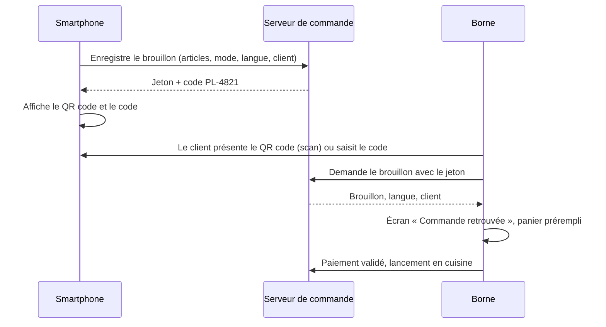

# Réponse au sujet « Adaptation d'un parcours de commande » — PastaLaVista

Sujet : *Adaptation d'un parcours de commande (menu / commande / paiement) dans un fastfood* (SujetAdaptation2627VF).
Ce document répond point par point aux axes **Utilisateurs** et **Dispositifs**, présente les matrices et les règles d'adaptation, les compositions, et la suite prévue (moteur d'adaptation et IA).

> Les valeurs chiffrées (seuils, durées, prix, kcal) sont des **hypothèses de maquette** à valider et à calibrer. Les données du menu sont fictives.

## Sommaire

1. Périmètre et livrables
2. Contexte, tâches et IHM standard
3. Axe Utilisateurs (points 1 à 6)
4. Axe Dispositifs (points 1 à 6)
5. Compositions des adaptations
6. Règles d'adaptation (synthèse)
7. Continuité de l'expérience et accessibilité
8. Étape 2 : moteur d'adaptation et IA
9. Hypothèses et points à valider

---

## 1. Périmètre et livrables

| Élément du sujet | Choix de l'équipe |
|---|---|
| IHM standard (satisfaisantes pour tous) | Faite : 4 écrans de borne |
| Axe Utilisateurs (obligatoire) | Fait : 2 personas, Jérémy et Alexovitch |
| Un axe au choix parmi Dispositifs et Environnement | **Dispositifs** (smartphone + borne). L'axe Environnement (météo, rush) n'est pas traité |
| Compositions des adaptations | Utilisateur × dispositif (section 5) |
| Maquettes haute fidélité | Canvas Claude Design (privé) et fichier `prototypes/pastalavista-prototype.html` |
| Code front-end sans interconnexion | À faire en React + Vite à partir du prototype |
| Matrices et règles d'adaptation | Sections 3, 4 et 6 |
| Moteur d'adaptation et IA (étape 2) | Pistes en section 8 |

Documents liés : [axe-utilisateurs.md](axe-utilisateurs.md), [axe-dispositifs.md](axe-dispositifs.md), [tableau-comparatif-parcours.md](tableau-comparatif-parcours.md), [adaptation-alexei-lenteur.md](adaptation-alexei-lenteur.md), [requirements-prototype.md](requirements-prototype.md).

## 2. Contexte, tâches et IHM standard

**Enjeu.** Dans la restauration rapide, la borne est le point de contact principal avec le client. Deux objectifs :

1. avoir un maximum de clients et les satisfaire (files fluides) ;
2. faire passer un maximum de commandes (pousser des produits et des offres, ventes additionnelles).

**Tâches principales des clients :** (1) choisir des produits, (2) commander, (3) payer.

**IHM standard de la borne** (portrait 810×1440 dans la maquette). Même ossature sur tous les écrans, qui ne change **jamais** lors d'une adaptation :

| Zone | Rôle |
|---|---|
| Barre du haut | Logo, langue, accessibilité, aide (ou badge du client connecté) |
| Étapes | Choisir › Commander › Payer |
| Rail à gauche | Catégories du menu (Composer, Populaires, Boissons, Desserts, Menus) ou étapes de composition (Pâtes, Sauce, Garnitures, Extras) |
| Contenu | Grille de produits ou de choix |
| Panier permanent | Lignes, total, « Annuler » et « Payer », toujours au même endroit |
| Bande terminal | Rappel du lecteur de carte physique |

Écrans standard : **Accueil** (où mangez-vous, QR code de connexion, langues), **Menu** (populaires + « Composer mon assiette »), **Composer** (choix pas à pas), **Paiement** (récapitulatif, suggestion de boisson, moyen de paiement).

---

## 3. Axe Utilisateurs

### Point 1 — Identifier des groupes d'utilisateurs différents

Groupes retenus par l'équipe :

| Groupe | Caractéristiques |
|---|---|
| **Jeunes adultes et personnes dans la vie active** | Pressés, souvent en pause courte, à l'aise avec la technologie, habitués du lieu |
| **Touristes qui n'ont pas l'habitude de manger des pâtes et ne peuvent pas se faire à manger** | Ne connaissent pas le concept ni les produits, souvent non francophones, moins à l'aise avec la borne, pas de contrainte de temps |

Autres groupes identifiés (pistes non retenues, pour montrer le domaine de plasticité possible) : familles avec enfants, seniors, personnes en situation de handicap (basse vision, mobilité réduite), clients très attentifs à la nutrition, groupes qui commandent à plusieurs.

### Point 2 — Choisir 2 groupes assez différents dans leurs attentes

Les deux groupes sont opposés sur presque tous les critères : le premier cherche la **vitesse** et la répétition d'un choix connu, le second cherche la **compréhension**, la réassurance et un choix adapté à son besoin.

| | **Jérémy Martin** (habitué) | **Alexovitch Dimitri Alexei** (touriste) |
|---|---|---|
| Profil | Étudiant Skema, termine à 12 h le mercredi, vient chaque semaine avec ses collègues | Bodybuilder russe, trouve le restaurant par hasard dans la rue |
| Technologie | À l'aise | Peu à l'aise, **lent** |
| Langue | Français | **Russe**, pas de français |
| Compte client | **Oui** | Non (client invité) |
| Temps | Doit retourner travailler | Aucune contrainte |
| Objectif | Refaire vite son plat favori | Beaucoup de sucres lents et de protéines, repas sain et adapté à ses besoins |
| Risque | Perdre du temps | Se perdre, ne pas comprendre, abandonner |
| Panier | Stable | Élevé (gros appétit) |

Scénarios détaillés : voir [axe-utilisateurs.md](axe-utilisateurs.md) et [axe-dispositifs.md](axe-dispositifs.md).

### Point 3 — Tableau comparatif des parcours d'IHM

Critères choisis par rapport aux trois tâches principales (contenu, présentation, dialogue). Version condensée, la version complète est dans [tableau-comparatif-parcours.md](tableau-comparatif-parcours.md).

| Tâche | Critère | IHM standard | Jérémy | Alexovitch |
|---|---|---|---|---|
| Accueil | Reconnaissance | Aucune | Scan du QR code, compte connu | Langue non française + comportement |
| Accueil | Contenu | Où mangez-vous, populaires | « Votre habituelle » en premier | Choix de langue, explication du concept en 3 étapes |
| Choisir | Point d'entrée | Catégories | Favoris, habituelle | Parcours guidé (Pâtes › Sauce › Protéine › Ajouts › Vérification) |
| Choisir | Information | Nom, photo, prix | Nom et prix | Description simple, **kcal et protéines**, mention « sucres lents » |
| Choisir | Charge cognitive | Moyenne | Très faible | Faible, un sujet par écran |
| Commander | Personnalisation | Options standard | Options préremplies, panier déjà rempli | Suggestions selon son besoin (portion XL, protéines ×2) |
| Commander | Vente additionnelle | Générique | **Une seule**, légère | Pertinente pour son besoin, sans pression |
| Commander | Récapitulatif | Complet | Court | Détaillé avec total kcal et protéines |
| Payer | Moyen de paiement | Au choix | Carte enregistrée par défaut | Carte, avec consignes illustrées |
| Payer | Guidage | Standard | Minimal | « Où payer » explicite, étapes numérotées dans sa langue |
| Transversal | Taille des éléments | Standard | Standard | Agrandis |
| Transversal | Temps visé | Moyen | Très court | Long toléré (délai d'inactivité allongé) |
| Transversal | Panier moyen | Modéré | Maintenu | Élevé |

### Point 4 — Maquetter les IHM standard et celles des deux personas

Les maquettes haute fidélité sont dans le canvas Claude Design (privé) et dans [prototypes/pastalavista-prototype.html](../prototypes/pastalavista-prototype.html), navigable.

| Parcours | Écrans |
|---|---|
| Standard | Accueil, Menu, Composer, Paiement |
| Jérémy | Accueil reconnu (« Votre habituelle », favoris, panier prérempli), Paiement express (carte enregistrée, une seule suggestion) |
| Alexovitch (en russe) | Choix de la langue, Découvrir le concept, Composition guidée (étape Protéine, kcal et protéines, offre d'aide), Récapitulatif et « où payer » |

### Point 5 — Reconnaître dynamiquement un profil

**Principe.** Personnalisation **passive** (profil dynamique) : on part d'un profil prototype et on l'affine pendant l'usage. Pour Jérémy la reconnaissance est **explicite** (compte), pour Alexovitch elle est **déduite** du comportement.

| Signal | Jérémy | Alexovitch |
|---|---|---|
| Scan du QR code et compte connu | **Déclencheur principal** | Absent (profil « invité ») |
| Historique des commandes | Commande habituelle, fréquence | Aucun |
| Langue choisie | Français | Non française : forte présomption |
| Temps avant le premier tap | Court | Long |
| Délai entre deux actions | Court | Long |
| Temps passé sur un écran | Court | Long (il lit) |
| Retours arrière, allers-retours | Rares | Fréquents (hésitation) |
| Taps ratés ou répétés | Rares | Fréquents |
| Modification des recettes | Rare (choix connu) | Fréquente (cherche son besoin) |

**Algorithme proposé (à calibrer) :**

1. Au démarrage : profil standard.
2. Si compte connu avec au moins 3 commandes : profil **habitué** (Jérémy).
3. Sinon, calcul d'un **score de guidage** entre 0 et 1, pondéré : langue non française (0,3), lenteur relative (0,3), retours arrière (0,2), taps ratés (0,2).
4. Lenteur **relative** : délai médian sur les 4 dernières actions supérieur à 2 fois le délai de référence de l'écran.
5. Entrée en mode **guidé** si le score est supérieur ou égal à 0,6. Sortie si le score reste inférieur à 0,3 (**hystérésis**).
6. On ne bascule qu'**à la fin d'une étape**, jamais au milieu d'un choix.

Précautions : un client qui lit simplement le menu ne doit pas être classé lent (signaux croisés, seuil relatif) ; les données de comportement ne sont gardées que le temps de la session, sans être rattachées à une personne (RGPD). Détail : [adaptation-alexei-lenteur.md](adaptation-alexei-lenteur.md).

### Point 6 — Passer d'une IHM standard à une IHM personnalisée

**Règles de transition** (section 6 pour la liste complète) :

| Situation | Déclencheur | Transition | Retour |
|---|---|---|---|
| Standard → Jérémy | QR code scanné, compte habitué | L'accueil se reconfigure sur la même ossature : « Votre habituelle » passe en premier, le panier est prérempli. Animation d'environ 300 ms, état conservé | Bouton « Modifier » ou « Composer » : le catalogue complet reste accessible |
| Standard → Alexovitch | Score de guidage supérieur ou égal à 0,6 | **Proposition d'aide** (« Нужна помощь? ») : accepter, appeler un employé ou refuser. Les éléments d'aide arrivent progressivement, boutons plus grands, descriptions et kcal visibles | Si le score retombe sous 0,3, ou si le client refuse : retour au standard à la fin de l'étape |

**Matrice d'adaptation, Jérémy** (variable de contexte : *le client est reconnu comme habitué*) :

| Tâche | Contenu | Présentation | Dialogue | Règle de transition |
|---|---|---|---|---|
| Accueil | « Bonjour Jérémy », habituelle, favoris | Grande carte mise en avant | Une touche pour commander | Déclenchée par le scan, sans saut d'écran |
| Choisir | Favoris et populaires | Rail avec « Mes favoris » en premier | Pas de questions d'aide | Catalogue complet toujours accessible |
| Commander | Panier prérempli | Panier permanent inchangé | Une seule suggestion | Suggestion retirée si le client l'ignore |
| Payer | Carte enregistrée | Un seul gros choix | Pas de guidage | « Autre moyen de paiement » disponible |

**Matrice d'adaptation, Alexovitch** (variable de contexte : *score de guidage supérieur ou égal à 0,6*) :

| Tâche | Contenu | Présentation | Dialogue | Règle de transition |
|---|---|---|---|---|
| Accueil | Langue, concept en 3 étapes, kcal et protéines annoncés | Grands boutons | Parcours guidé | Proposé dès le choix de langue |
| Choisir | Descriptions simples, kcal, protéines | Lignes de choix larges avec quantité | Étapes numérotées | Passage à l'étape suivante à son rythme |
| Commander | Suggestions selon son besoin (XL, protéines) | Total kcal et protéines visible en permanence | Confirmation à chaque étape | Aucune pression de vente |
| Payer | « Où payer » explicite | Flèche et étapes numérotées | Délai d'inactivité allongé | Aide humaine proposée si blocage |

---

## 4. Axe Dispositifs

Solution hybride : le client prépare sa commande sur son **smartphone** (en mobilité ou avant de venir) puis la **finalise à la borne**, qui lance la préparation en cuisine.

### Point 1 — Tâches proposées sur chaque dispositif

| Tâche | Smartphone | Borne |
|---|---|---|
| Choisir ses produits, composer son assiette | **Oui** | Oui (parcours complet pour qui n'a rien préparé) |
| Consulter descriptions, kcal et protéines | Oui | Oui |
| Retrouver favoris et habituelle | Oui | Oui (si connecté) |
| Choisir sur place ou à emporter | Oui | Oui |
| Choisir la langue | Oui | Oui |
| Chatbot d'aide à la commande | **Oui** | Option (voir point 6) |
| Générer le QR code de commande | **Oui** | Non |
| Scanner le QR code et retrouver la commande | Non | **Oui** |
| Vérifier le récapitulatif | Oui (court) | **Oui** (final) |
| Modifier au dernier moment | Oui, avant la finalisation | Oui |
| **Payer** | **Non** (hypothèse) | **Oui** |
| Lancer la préparation en cuisine | Non | **Oui** |
| Obtenir le numéro de commande | Non | **Oui** |

### Point 2 — Tableau comparatif des parcours d'IHM

| Critère | Smartphone | Borne |
|---|---|---|
| Spécificités du dispositif | Personnel, mobile, petit écran, utilisé à une main, connexion variable | Public, fixe, grand écran tactile, lecteur de carte physique, caméra ou lecteur de QR |
| Lieu et moment | N'importe où, avant l'arrivée | Dans le restaurant, au moment de finaliser |
| Identification | Compte déjà connecté | QR code ou code de commande |
| Disposition | Une colonne, un sujet par écran, bouton principal en bas | Ossature multi-zones : barre, étapes, rail, contenu, panier permanent, terminal |
| Zones tactiles | Au moins 44 px, adaptées au pouce | Au moins 72 px, jusqu'à 110 px pour les boutons principaux |
| Densité d'information | Faible | Plus élevée mais structurée |
| Saisie | Clavier, chatbot | Tactile, scan, saisie du code en secours |
| Paiement | Aucun | Carte, mobile, espèces |
| Durée d'usage | Courte et interrompue | Une session continue, délai d'inactivité |
| Langue | Version web sans installation, dans la langue du client | Langue choisie à l'écran ou reprise de la commande |
| Accessibilité | Réglages du téléphone | Bouton accessibilité dédié, grandes cibles |
| Confidentialité | Données du compte sur un appareil personnel | Écran public : ne rien laisser affiché après la session |

### Point 3 — IHM standard impactées et nouvelles IHM smartphone

| IHM standard de la borne | Impact | Nouvelle IHM sur smartphone |
|---|---|---|
| Accueil | Fort : pas de grand écran d'accueil ni de « terminal » | Accueil réduit : bonjour, mode sur place ou à emporter, habituelle |
| Menu | Fort : pas de rail ni de grille à 2 colonnes | Liste en une colonne |
| Composer | Moyen : rail d'étapes remplacé | Étapes une par une, une colonne |
| Paiement | **Supprimé** sur smartphone | Écran « Votre commande est prête » avec QR code et code PL-4821 |
| Panier permanent | Remplacé | Récapitulatif court, bouton principal en bas |
| (nouveau) | Chatbot | Écran de chat avec carte de suggestion |
| (nouveau, borne) | Commande retrouvée | Écran de la borne après scan du QR code |

Maquettes : smartphone 1 (Jérémy prépare sa commande), smartphone 2 (QR code de commande), smartphone 3 (Alexovitch et le chatbot, en russe), borne « Commande retrouvée ».

### Point 4 — Reconnaître dynamiquement le changement de dispositif

| Signal | Ce qu'il indique | Fiabilité |
|---|---|---|
| Largeur d'écran, type de pointeur (tactile), agent utilisateur | Smartphone ou borne | Moyenne |
| Identifiant de borne fourni par le QR code affiché sur la borne | L'appareil qui scanne est un smartphone devant une borne précise | Forte |
| Jeton de commande présenté à la borne (QR code du smartphone) | Le client **passe** du smartphone à la borne | Forte |
| Mode « borne » configuré sur l'appareil (kiosque) | Borne | Forte |
| Compte connecté puis scan | Même client sur deux appareils | Forte |
| Code de commande saisi | Passage sans smartphone (batterie vide) | Forte |

Le **changement de dispositif** est détecté au moment où la borne **reçoit un jeton de commande valide** (scan ou saisie du code). Il n'est jamais supposé à partir de la seule taille d'écran.

### Point 5 — Passer de l'IHM du smartphone à celle de la borne



Règles de passage :

1. **Rien n'est envoyé en cuisine** tant que le paiement n'est pas fait à la borne.
2. Le brouillon contient articles, options, mode (sur place ou à emporter), langue et identité du client. La borne les reprend **sans ressaisie** (état conservé).
3. Le jeton est à usage unique et expire (par exemple 30 minutes, à calibrer).
4. Si le brouillon a déjà été payé ou a expiré, la borne l'indique clairement et propose de recommencer.
5. **Secours** : saisie du code PL-xxxx si le téléphone est déchargé.
6. La borne reprend la **langue** du smartphone (un client russe continue en russe).
7. Même ossature de borne : le seul changement visible est le bandeau « Commande retrouvée » et le panier déjà rempli.

### Point 6 — Possibilité d'ajouter un chatbot pour la prise de commande

**Verdict : oui**, surtout sur smartphone, et pour les clients qui ne savent pas quoi choisir (Alexovitch).

| Question | Réponse |
|---|---|
| Où | Smartphone (priorité) ; borne en option, bouton d'aide |
| Pour qui | Alexovitch (traduction, choix selon un besoin : sucres lents, protéines) ; Jérémy n'en a pas besoin |
| Fonctions | Proposer un plat selon un besoin, afficher kcal et protéines, répondre sur les ingrédients, ajouter au panier, **appeler un employé** |
| Limites | Pas de paiement dans le chat ; ne propose que des produits réels du menu ; ne donne pas de conseil médical |
| Mise en œuvre simple | Scénarios à règles (arbre de questions, filtres par kcal et protéines) |
| Mise en œuvre IA | Modèle de langage contraint par le catalogue (appels de fonctions, réponses structurées), traduction automatique |
| Risques | Réponses inventées, produits inexistants, données personnelles dans les messages |
| Mesures | Réponses limitées au catalogue, relecture, journalisation minimale, bascule vers un humain |

---

## 5. Compositions des adaptations

Les adaptations « utilisateur » et « dispositif » sont actives **en même temps**.

| | Smartphone | Borne |
|---|---|---|
| **Jérémy** | Disposition smartphone + contenu « habitué » : habituelle en tête, pas de paiement, QR code | Disposition borne + « habitué » : scan, commande retrouvée, paiement express |
| **Alexovitch** | Disposition smartphone + « guidé » : langue, descriptions, kcal et protéines, chatbot | Disposition borne + « guidé » : étapes numérotées, offre d'aide, « où payer » |

**Priorités en cas de conflit :**

1. **Accessibilité et langue** passent avant tout.
2. Le **dispositif** décide de la **disposition** (zones, tailles, où se trouve le paiement).
3. L'**utilisateur** décide du **contenu et du dialogue** (ce qui est montré, les questions posées, les suggestions).
4. Les délais d'inactivité allongés s'appliquent uniquement à la borne (écran public).
5. En cas de rush ou d'autre contexte futur, la fluidité de la file primerait sur la vente additionnelle (hors périmètre actuel).

## 6. Règles d'adaptation (synthèse)

| N° | Condition | Action | Niveau |
|---|---|---|---|
| RU1 | Compte connu avec au moins 3 commandes | Profil habitué : habituelle en premier, panier prérempli | Contenu |
| RU2 | Profil habitué | Parcours en 2 étapes, une seule suggestion, carte enregistrée par défaut | Dialogue |
| RU3 | Langue choisie différente du français | Interface traduite ; ajout du critère « langue » au score de guidage | Contenu |
| RU4 | Score de guidage supérieur ou égal à 0,6 | Proposer l'aide ; mode guidé | Dialogue |
| RU5 | Mode guidé | Descriptions, kcal et protéines visibles ; boutons agrandis ; un sujet par écran | Contenu, présentation |
| RU6 | Mode guidé sur la borne | Délai d'inactivité allongé (par exemple 30 s → 90 s) avec alerte avant remise à zéro | Dialogue |
| RU7 | Mode guidé | Ventes additionnelles liées au besoin (XL, protéines), sans pression | Contenu |
| RU8 | Score de guidage inférieur à 0,3 ou refus | Retour au standard à la fin de l'étape | Dialogue |
| RD1 | Appareil tactile étroit hors mode borne | Disposition smartphone | Présentation |
| RD2 | Smartphone | Pas de paiement ; génération du jeton, du QR code et du code | Dialogue |
| RD3 | Borne reçoit un jeton valide | Écran « Commande retrouvée », panier repris, langue reprise | Contenu, dialogue |
| RD4 | Téléphone indisponible | Saisie du code de commande à la borne | Dialogue |
| RD5 | Brouillon expiré ou déjà payé | Message explicite, proposition de recommencer | Contenu |
| RD6 | Profil « guidé » ou demande d'aide sur smartphone | Proposer le chatbot ; option « appeler un employé » à la borne | Dialogue |

Toutes les adaptations respectent : état conservé, transition d'environ 300 ms, ossature et boutons critiques inchangés, retour possible, seuils en configuration.

## 7. Continuité de l'expérience et accessibilité

| Consigne du cours | Application dans les maquettes |
|---|---|
| Préserver l'état | Panier et étape conservés lors d'une adaptation et lors du passage smartphone → borne |
| Lisser les transitions | Changements de taille et d'agencement animés (environ 300 ms), sans clignotement |
| Identifier le bon moment | Seuil de score, nombre d'observations et basculement à la fin d'une étape |
| Éviter les oscillations | Hystérésis : entrée à 0,6, sortie sous 0,3 |
| Conserver la structure | Même ossature de borne, panier et boutons critiques à la même place |
| Réversibilité | « Modifier », « Autre moyen de paiement », refus de l'aide, retour au standard |

**Accessibilité minimale visée :** contrastes de niveau WCAG AA (par exemple rouge #C8321B sur blanc ≈ 5,3:1, vert #1F6B43 sur blanc ≈ 6,5:1, calculs manuels à confirmer avec un outil), cibles tactiles d'au moins 44 px (borne : 72 px et plus), information jamais portée par la couleur seule, bouton d'accessibilité sur la borne, éléments interactifs en vrais boutons et liens.

## 8. Étape 2 : moteur d'adaptation et IA

**Architecture cible (React + Vite) :**

```
Capteurs et événements  →  Modèle de contexte  →  Moteur d'adaptation  →  Configuration d'IHM  →  Composants React
(QR, langue, délais,       (profil, dispositif,     (règles RU/RD,          (variantes de contenu,   (mêmes composants
 retours arrière…)          score de guidage)        hystérésis, priorités)  présentation, dialogue)  pour borne et smartphone)
```

**Solution 1 : moteur à règles statiques.** Les règles RU et RD sont des données (condition, action, niveau, priorité) évaluées par le moteur, avec seuils en configuration. Un panneau de développement permet de forcer un profil ou un dispositif pour démontrer chaque adaptation.

**Solution 2 : IA multi-niveaux.**

| Niveau | Rôle | Technique envisagée |
|---|---|---|
| Identification du contexte | Estimer le profil (habitué, besoin de guidage) à partir des interactions | Classifieur sur des variables d'interaction (délais, retours arrière, taps), calibré sur des sessions simulées |
| Dialogue | Chatbot de commande, traduction | Modèle de langage contraint par le catalogue (réponses structurées) |
| Génération d'UI | Choisir et composer des variantes d'IHM | Génération d'une **description d'IHM** (JSON) limitée à la bibliothèque de composants, validée par des règles de continuité et d'accessibilité |

**Évaluation :** temps de commande, taux d'abandon, nombre d'erreurs de tap, panier moyen, satisfaction, nombre de déclenchements à tort de l'aide.

## 9. Hypothèses et points à valider

- Répartition des tâches : **pas de paiement sur le smartphone**.
- Mécanisme de passage de relais : QR code, code de commande, compte ; durée de validité du jeton.
- Seuils et pondérations du score de guidage, délai d'inactivité allongé.
- Présence du chatbot sur la borne.
- Langue de l'interface : français, russe et d'autres langues ; textes russes à faire relire.
- Données du menu (produits, prix, kcal, protéines) fictives.
- Outil et conditions d'évaluation des adaptations (tests utilisateurs, mesures).
